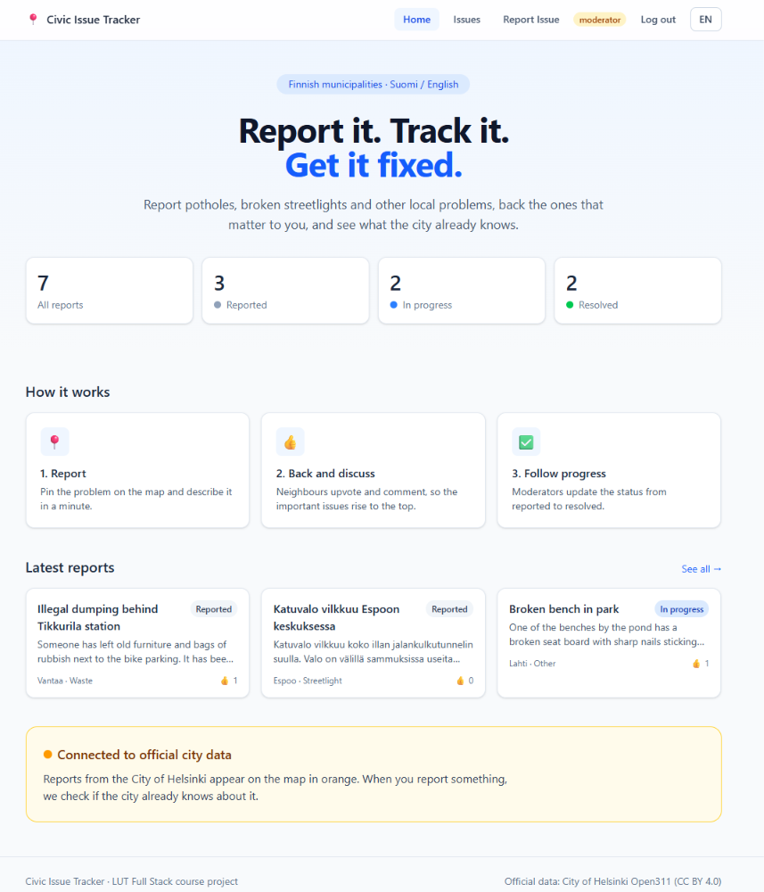
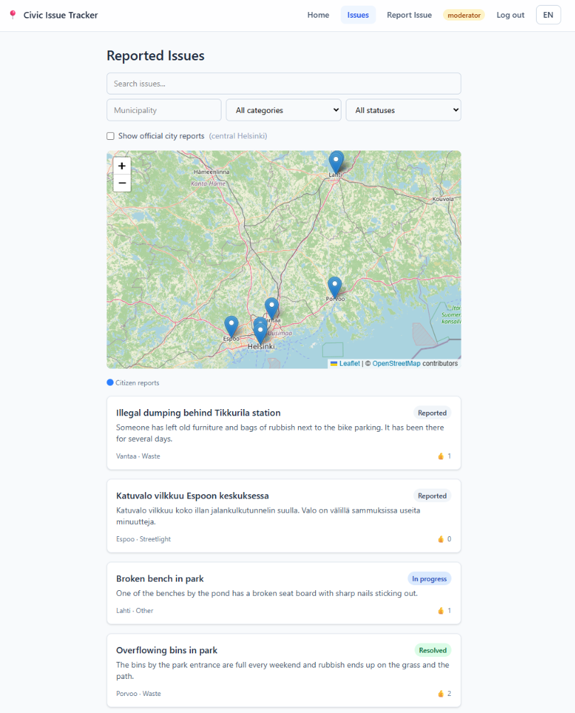
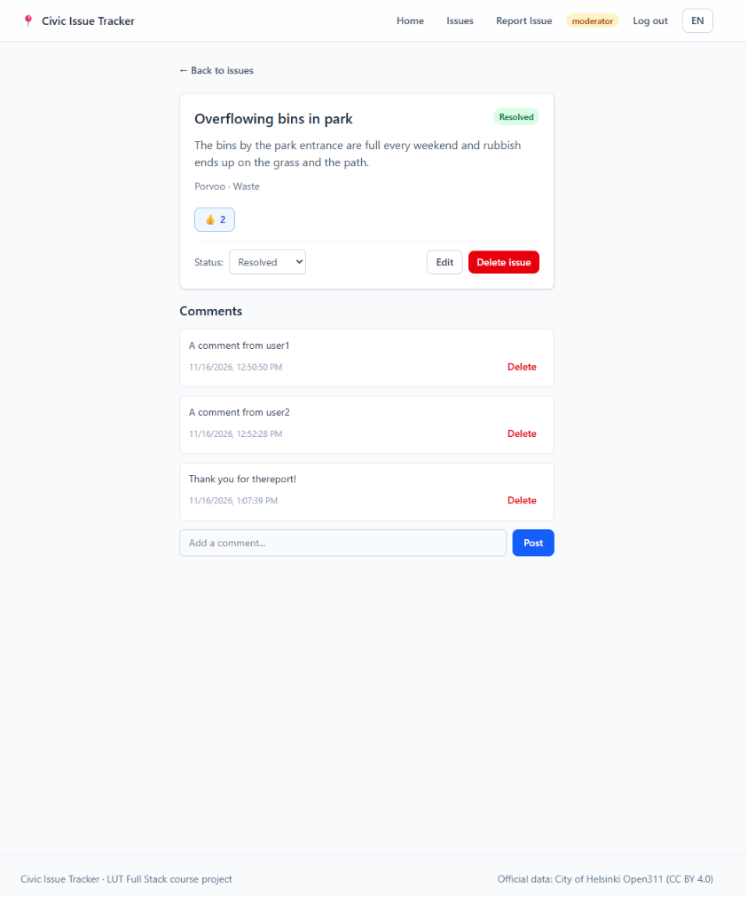
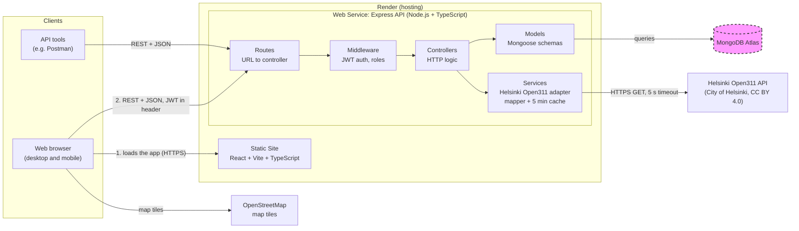
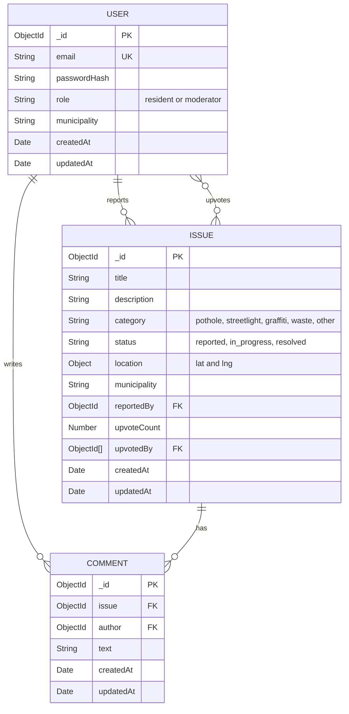

# Civic Issue Tracker

[](https://github.com/DenisHki/civic-issue-tracker/actions/workflows/ci.yml)

Report local problems in Finnish municipalities, back the ones that matter to you, and follow them until they are fixed. The app also shows official reports from the City of Helsinki on the same map. Available in Finnish and English.

**Live demo:** <https://civic-issue-tracker-ofms.onrender.com/>

> The server runs on a free Render plan and goes to sleep after about 15 minutes without traffic. If the page shows no data at first, wait up to a minute and reload.



## Quick start

You need [Node.js](https://nodejs.org/) 20 or newer and a MongoDB database (either MongoDB installed on your computer, or a free [MongoDB Atlas](https://www.mongodb.com/atlas) cluster).

**1. Get the code and install the packages**

```powershell
git clone https://github.com/DenisHki/civic-issue-tracker.git
cd civic-issue-tracker
npm install
```

One `npm install` in the project root installs both the client and the server.

**2. Create the settings files**

```powershell
Copy-Item server/.env.example server/.env
Copy-Item client/.env.example client/.env
```

On macOS or Linux use `cp` instead of `Copy-Item`.

Open `server/.env` and set your own values:

| Variable | Meaning |
| --- | --- |
| `NODE_ENV` | `development` on your computer |
| `PORT` | Port of the API (default `4000`) |
| `MONGO_URI` | Address of your MongoDB database |
| `JWT_SECRET` | A long random text used to sign login tokens (at least 32 characters in production) |
| `CORS_ORIGIN` | Address of the client that may call the API (default `http://localhost:5173`) |

`client/.env` has one variable, `VITE_API_URL`, the address of the API (default `http://localhost:4000/api`).

The `.env` files are ignored by Git. Never commit them, and never share your database address or your secret.

**3. Start the app** (two terminals, both in the project root)

```powershell
npm run dev:server
```

```powershell
npm run dev:client
```

Open <http://localhost:5173>.

## How to use the app

**As a visitor (no account)**
- The home page shows live numbers: all reports, and how many are reported, in progress and resolved.
- Open **Issues** to search and filter reports by text, municipality, category and status. Click a card to open the report with its comments.
- Turn on **Show official city reports** to see City of Helsinki reports as orange markers on the map.

**As a resident**
1. Click **Register**, enter your email, a password and your municipality. You are logged in right away.
2. Click **Report Issue**, fill in the title, description, category and municipality, and click on the map to place a pin. If the city already has a report within 100 metres, the app shows it before you send yours.
3. Open any report to **upvote** it or write a **comment**.
4. You can edit or delete your own reports.

**As a moderator**
- A moderator can change the status of any report (reported, in progress, resolved) and edit or delete any report.
- New accounts are residents. To make a moderator, set the user's `role` to `moderator` in the database, then log in again (the role is stored in the login token).

## Features

- Reports with category, status, description and a map location
- Search and filters by text, municipality, category and status
- Upvotes and comments, so residents can show which problems matter
- Two roles (resident and moderator) with permissions checked on the server
- Live statistics on the home page
- Official City of Helsinki reports (Open311) as a map layer, and a nearby-reports hint when reporting
- Finnish and English interface
- Responsive layout for phone and desktop, toast messages, and a 404 page

## Screenshots

| Issues and map | Report with comments |
| --- | --- |
|  |  |

## Technology

| Part | Technology |
| --- | --- |
| Client | React, Vite, TypeScript, Tailwind CSS, React Router, react-i18next, Leaflet |
| Server | Node.js, Express, TypeScript, Mongoose |
| Database | MongoDB (Atlas in production) |
| Tests | Vitest, Supertest, mongodb-memory-server |
| CI and hosting | GitHub Actions, Render |

## Architecture

### Communication flow



The browser loads the React app from the static site and then talks to the API with JSON over HTTPS. Every API request follows the same path: **route, middleware, controller, then model or service**. Only the models talk to the database, and only the services talk to outside APIs such as the City of Helsinki.

### Data model



**User.** A person with an account. `email` is unique. Only a bcrypt hash of the password is stored, and it is removed from every response. `role` is `resident` (default) or `moderator`.

**Issue.** A reported problem with a `category`, a `status` (`reported`, `in_progress`, `resolved`), a map position (`location.lat`, `location.lng`) and a `municipality`. `reportedBy` points to the author. Upvotes are stored inside the issue: `upvotedBy` lists the users who upvoted and `upvoteCount` keeps the number.

**Comment.** A text written by a user (`author`) on an issue (`issue`).

Official City of Helsinki reports are not stored in the database. They are fetched, mapped to our own shape and cached for 5 minutes by a separate service module on the server.


## Tests and quality checks

```powershell
npm run test:server    # 65 server tests, using an in-memory database
npm run lint:server
npm run lint:client
npm run build:server
npm run build:client
```

Every pull request runs lint, build and tests in GitHub Actions. The `main` branch is protected, so changes arrive only through pull requests with green checks.

## Data sources and credits

- Official reports: City of Helsinki Open311 API, licensed [CC BY 4.0](https://creativecommons.org/licenses/by/4.0/).
- Map: © [OpenStreetMap](https://www.openstreetmap.org/copyright) contributors, shown with [Leaflet](https://leafletjs.com/).
